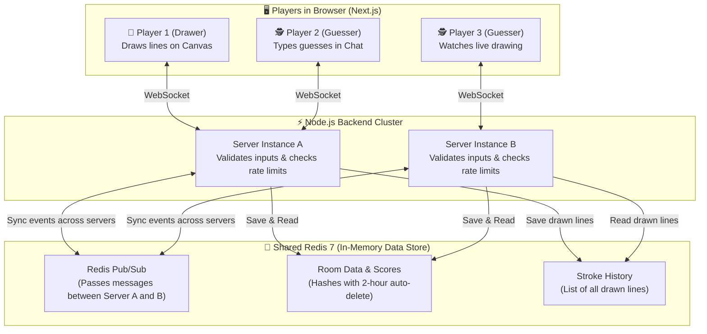
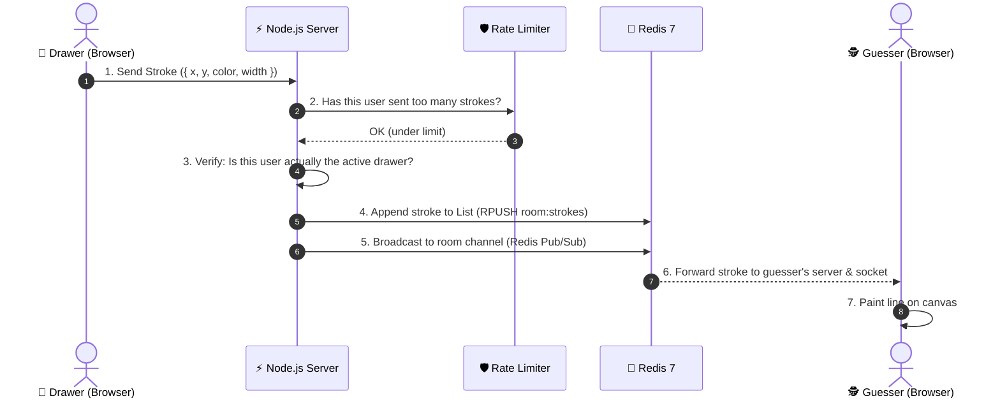
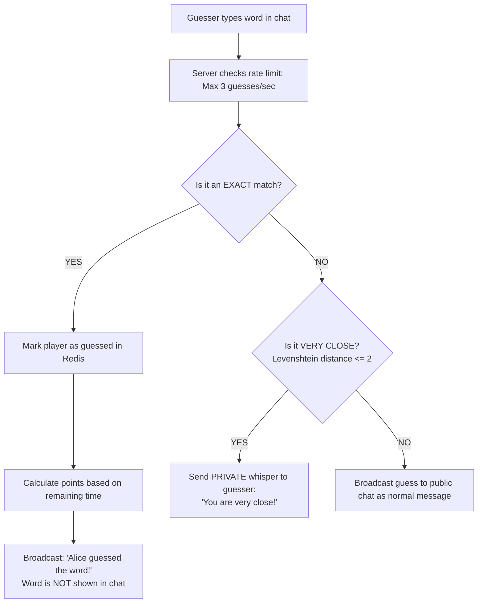
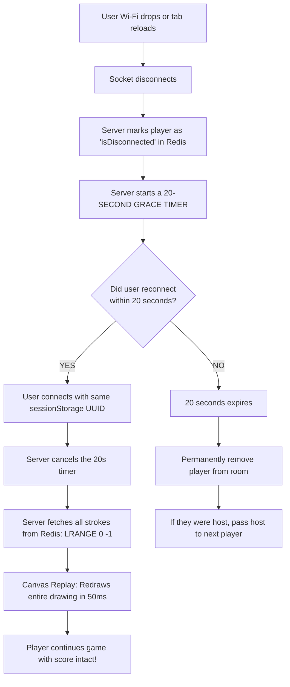

# 🎨 Doodl.io — Architecture & Interview Guide (Easy-to-Explain Version)

> **Quick Summary:** This guide explains the entire Doodl.io project in **simple, plain English**. It gives you clear diagrams, real-world analogies, and ready-to-use speaking scripts so you can confidently explain every single bullet on your resume during an interview.

---

## 📑 Table of Contents
1. [The 30-Second Project Introduction (How to Start)](#1-the-30-second-project-introduction-how-to-start)
2. [Big Picture Architecture (In Plain English)](#2-big-picture-architecture-in-plain-english)
3. [Step-by-Step Data Pipelines](#3-step-by-step-data-pipelines)
   - [Pipeline A: How Drawing Works (Stroke to Screen)](#pipeline-a-how-drawing-works-stroke-to-screen)
   - [Pipeline B: How Guessing & Scoring Works](#pipeline-b-how-guessing--scoring-works)
   - [Pipeline C: What Happens When Someone Disconnects](#pipeline-c-what-happens-when-someone-disconnects)
4. [Defending Resume Bullet #1: Horizontal Scaling & Redis Pub/Sub](#4-defending-resume-bullet-1-horizontal-scaling--redis-pubsub)
5. [Defending Resume Bullet #2: Zero-Trust State Machine & Epoch Timers](#5-defending-resume-bullet-2-zero-trust-state-machine--epoch-timers)
6. [Defending Resume Bullet #3: Reconnection & Rate Limiting](#6-defending-resume-bullet-3-reconnection--rate-limiting)
7. [The 5 Most Common Interview Questions & Simple Answers](#7-the-5-most-common-interview-questions--simple-answers)

---

## 1. The 30-Second Project Introduction (How to Start)

When the interviewer says: **"Tell me about this Doodl.io project."**

### 🗣️ Say this:
> *"Doodl.io is a real-time multiplayer drawing and guessing game, similar to Skribbl.io. I built the frontend with Next.js and the backend with Node.js, Socket.IO, and Redis.*
> 
> *The main engineering challenge was that real-time games require very low latency and high reliability. Most basic tutorials just store game state in normal JavaScript variables in memory, but that breaks the moment your server restarts or if you want to run more than one server.*
> 
> *So I designed Doodl.io with a **stateless backend** where all game rooms, player scores, and drawing strokes live in Redis. I also built a **5-state game machine** to prevent cheating, an **auto-reconnect system with canvas replay** if someone's Wi-Fi drops, and a **rate limiter** to protect the server from spam.*
> 
> *When I load-tested it with 20 automated players, it handled over 165 drawing strokes per second with an average delay of just 4 milliseconds."*

---

## 2. Big Picture Architecture (In Plain English)

### 💡 The Core Idea:
Think of the app as three distinct pieces working together:
1. **The Players (Client / Next.js):** Runs in the browser. Captures mouse/touch movements on an HTML5 canvas and sends them over WebSockets.
2. **The Traffic Controllers (Node.js Servers):** Stateless servers. They don't keep long-term data in memory. They just validate inputs (rate limits, anti-cheat), update Redis, and broadcast events to players.
3. **The Shared Brain (Redis 7):** A lightning-fast in-memory database that stores the active rooms, player scores, stroke history, and routes messages between servers.

---

## 3. Step-by-Step Data Pipelines

### Pipeline A: How Drawing Works (Stroke to Screen)

#### 🗣️ How to explain this simply:
1. **Normalized Coordinates:** "We don't send raw pixels like `x=500, y=300` because a phone screen is small and a monitor is huge. Instead, we divide by the canvas width and height so `x` and `y` are always decimals between `0.0` and `1.0`. Every device multiplies that decimal by its own screen size, so the drawing looks identical on every screen."
2. **Rate Limit Gate:** "Before doing anything, the server checks if the user is sending too fast (rate limit). This prevents macro scripts from lagging the server."
3. **Saving & Broadcasting:** "If valid, the server saves the line to a Redis list and broadcasts it to all other players in the room in about 4 milliseconds."

---

### Pipeline B: How Guessing & Scoring Works

#### 🗣️ How to explain this simply:
* **Anti-Cheat:** "When a player guesses correctly, we don't display their answer in chat, because that would ruin the game for everyone else. We broadcast a green message saying *'Alice guessed the word!'* and give her points."
* **Close Guess Detection:** "If someone makes a small spelling mistake like typing `applle` instead of `apple`, we calculate the **Levenshtein distance** (edit distance). If it's only off by 1 or 2 letters, we send a private whisper *only to that player* saying *'You're close!'*. We don't tell the whole room, so other players can't copy it."
* **Decaying Score Formula:** "The faster you guess, the more points you get. If you guess in the first 5 seconds you get up to 500 points; if you guess near the end, you get closer to 100 points."

---

### Pipeline C: What Happens When Someone Disconnects

#### 🗣️ How to explain this simply:
> *"Normally in WebSockets, if your connection drops for even one second, the server forgets you and resets your game. In Doodl.io, each tab stores a unique ID in `sessionStorage`. If your Wi-Fi flickers, the server gives you a 20-second grace period. When you reconnect, the server says 'Welcome back', keeps your points, pulls the drawing history from Redis, and replays all the strokes on your canvas so you never miss a beat."*

---

## 4. Defending Resume Bullet #1: Horizontal Scaling & Redis Pub/Sub

> **Resume Line:**  
> *"Created a horizontally scalable real-time engine with Socket.IO and Redis Pub/Sub, sustaining ~165 strokes/sec at 4ms p95 broadcast latency by moving room state out of Node.js memory."*

### What this means in plain English:
* **The Problem:** If you store games in Node.js variables (`const rooms = {}`), you are stuck on **one single server**. If 10,000 players join, you can't just spin up a second server because Server 1 doesn't know what's happening on Server 2.
* **The Solution:** We moved all data out of Node.js and into Redis. Then we plugged in **Redis Pub/Sub**. When Player A on Server 1 draws a stroke, Server 1 publishes that stroke to Redis, which forwards it to Server 2, which shows it to Player B.
* **The Benchmark Proof:** We wrote a script (`loadTest.ts`) that created 20 automated bot players in a room. One bot drew continuously at 60 frames per second, emitting ~165 strokes every second. The other 19 bots measured the time it took for the stroke to arrive. 95% of all strokes arrived in **4 milliseconds or less** (p95 latency).

### 🗣️ How to defend this in the interview:
> **Interviewer:** *"Why did you move room state out of Node.js memory into Redis?"*  
> **Your Answer:**  
> *"If you store rooms in Node.js memory, two bad things happen:  
> 1. If your Node process restarts, every active game is instantly lost.  
> 2. You cannot scale beyond a single machine.  
> By moving the state to Redis and using Redis Pub/Sub via the Socket.IO Redis adapter, our Node servers become completely stateless. We can add 5 more Node servers behind a load balancer, and players in the same room can be connected to different servers without noticing any difference."*

---

## 5. Defending Resume Bullet #2: Zero-Trust State Machine & Epoch Timers

> **Resume Line:**  
> *"Constructed a zero-trust, server-authoritative 5-state machine with epoch-anchored timers and server-side word masking, preventing client clock manipulation and payload tampering."*

### What this means in plain English:
1. **5-State Game Machine:** The game moves strictly through 5 predictable stages:
   $$\text{Waiting (Lobby)} \longrightarrow \text{Choosing (Pick word)} \longrightarrow \text{Drawing} \longrightarrow \text{Round End} \longrightarrow \text{Game End}$$
2. **Zero-Trust Word Masking:** In bad games, the server sends `{ word: "apple" }` to everyone and hides it with CSS. Anyone who opens Chrome DevTools can inspect the network frame and cheat. In our system, the secret word is **only sent to the drawer**. Guessers only receive `_ _ _ _ _`. The secret word stays on the server.
3. **Epoch-Anchored Timers:** Instead of running a naive `setInterval` countdown (which drifts whenever the computer is busy), we set a fixed deadline in the future:
   $$\text{roundEndsAt} = \text{Current Time} + 60 \text{ seconds}$$
   Every second we simply calculate: `timeLeft = roundEndsAt - Current Time`. Even if a player changes their computer clock or lags for 5 seconds, the server's time cannot be manipulated.

### 🗣️ How to defend this in the interview:
> **Interviewer:** *"How did you prevent players from cheating to see the word or extending their time?"*  
> **Your Answer:**  
> *"We follow a zero-trust approach: the client is never trusted.  
> For the word: The 3 word choices are transmitted over a private socket message strictly to the drawer. Guessers only receive the word's character count. The secret word is stored on the server in Redis, so it's physically impossible to find it in browser DevTools.  
> For the timer: We don't trust client clocks or simple intervals. The server computes an immutable timestamp for when the round must end (`roundEndsAt = Date.now() + duration`). Even if a client tries to pause their JavaScript or modify their system clock, the server closes the round at the exact epoch timestamp."*

---

## 6. Defending Resume Bullet #3: Reconnection & Rate Limiting

> **Resume Line:**  
> *"Established fault-tolerant state recovery with an append-only Redis stroke log and a 20s reconnect grace period, protecting the event loop via per-socket token-bucket rate limiting."*

### What this means in plain English:
1. **Append-Only Stroke Log:** Every line drawn is saved to a list in Redis using `RPUSH`. If a player reloads the page, the server reads the whole list and replays it on their screen in milliseconds.
2. **20-Second Reconnect Grace Period:** If someone's connection drops, we don't delete them immediately. We hold their spot, score, and team for 20 seconds. If they come back, they pick up right where they left off.
3. **Token-Bucket Rate Limiter:** If a hacker creates a bot that sends 10,000 drawing events per second, it would freeze Node.js (because Node.js is single-threaded). Our token-bucket limiter gives each player a "bucket" of tokens:
   * Drawing: 350 tokens/sec
   * Guessing: 3 guesses/sec
   * Clear Canvas: 2 clears/sec  
   If a script tries to spam faster than that, the extra events are instantly dropped without slowing down the server.

### 🗣️ How to defend this in the interview:
> **Interviewer:** *"What is token-bucket rate limiting, and why did you use it here?"*  
> **Your Answer:**  
> *"Node.js has a single-threaded event loop. If one user sends thousands of socket messages every second, it blocks the thread and lags the entire game for everyone.  
> We implemented a token-bucket rate limiter for each socket. The token bucket is great for drawing because drawing comes in natural human bursts—when you quickly sketch a circle, you generate a burst of coordinates. A token bucket allows that quick burst up to a cap (capacity of 500), but limits the steady rate to 350 events per second. It protects our server CPU and prevents someone from spamming Redis with thousands of unnecessary writes."*

---

## 7. The 5 Most Common Interview Questions & Simple Answers

### Q1: "Why did you use Redis instead of a normal database like PostgreSQL or MongoDB for room state?"
> **Simple Answer:**  
> *"In a fast drawing game, state changes 50 to 100 times every second (strokes, timers, guesses). Writing every stroke to a disk database like Postgres or Mongo would cause huge disk I/O bottlenecks and high latency.  
> Redis stores everything in RAM, giving us sub-millisecond read/write speeds. Plus, Redis has built-in TTL (Time-To-Live), so when a game ends, the room automatically deletes itself after 2 hours without needing cleanup scripts."*

---

### Q2: "Why Socket.IO instead of raw WebSockets (`ws`)?"
> **Simple Answer:**  
> *"Raw WebSockets only give you a basic connection. With Socket.IO, you get three massive features out of the box:  
> 1. **Rooms:** Built-in ability to group sockets by room ID (`socket.join(roomId)` and `io.to(roomId).emit(...)`).  
> 2. **Automatic Reconnection:** If mobile Wi-Fi drops, the client automatically tries to reconnect with exponential backoff.  
> 3. **Redis Adapter Support:** We can plug in the Redis Pub/Sub adapter with two lines of code to scale across multiple servers."*

---

### Q3: "What broke first when you started testing this?"
> **Simple Answer:**  
> *"Page refreshes and flaky connections broke first. Initially, whenever a player refreshed their browser, Socket.IO assigned them a brand-new socket ID. The server thought the player had quit, wiped their score, and restarted the round.  
> To fix this, I separated socket identity from player identity. I gave each player a persistent UUID in `sessionStorage` and added a 20-second grace window on disconnect. That way, a quick reload just reconnected the existing player rather than creating a new one."*

---

### Q4: "How does the canvas look the same on a mobile phone and a 4K desktop?"
> **Simple Answer:**  
> *"We use normalized coordinates between 0.0 and 1.0.  
> If my canvas is 1000 pixels wide and I click at pixel 500, my client sends `x = 0.5`.  
> When a phone with a 400-pixel screen receives `0.5`, it multiplies `0.5 * 400 = 200` and draws at pixel 200. This ensures the drawing has the exact same proportions on every screen size."*

---

### Q5: "What is the difference between DoS and DDoS, and which one did your rate limiter protect against?"
> **Simple Answer:**  
> *"Our token-bucket rate limiter protects against **application-level DoS (Denial of Service)** and spam—such as a single malicious client or bot blasting thousands of guess or stroke events to choke the Node.js event loop.  
> It does **not** protect against a distributed DDoS attack (thousands of distributed botnet computers flooding the network). A true network DDoS must be mitigated at the edge using a CDN or reverse proxy like Cloudflare or AWS Shield before traffic even reaches Node.js."*

---

## 🎯 Final Mental Checklist for Tomorrow

1. **Be proud of what you built:** This is not a toy tutorial project. It has real distributed systems patterns (Redis Pub/Sub, State Machines, Token Bucket, Reconnect Replay).
2. **Focus on WHY, not just WHAT:** Always mention the problem first (e.g., *“Normal intervals drift…”*), then your solution (*“…so I used epoch timestamps.”*).
3. **Speak calmly:** You know the code because you built it. If they ask a question, pause for 2 seconds, picture the data pipeline, and walk them through it step-by-step. Good luck!
