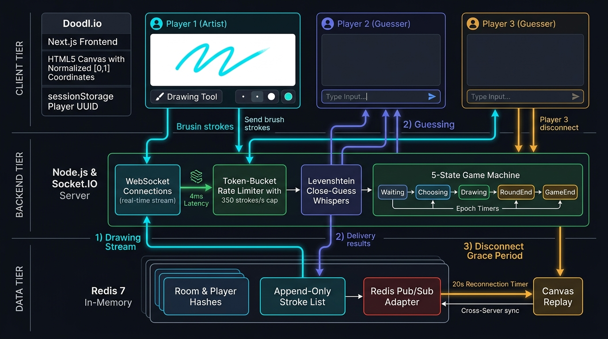
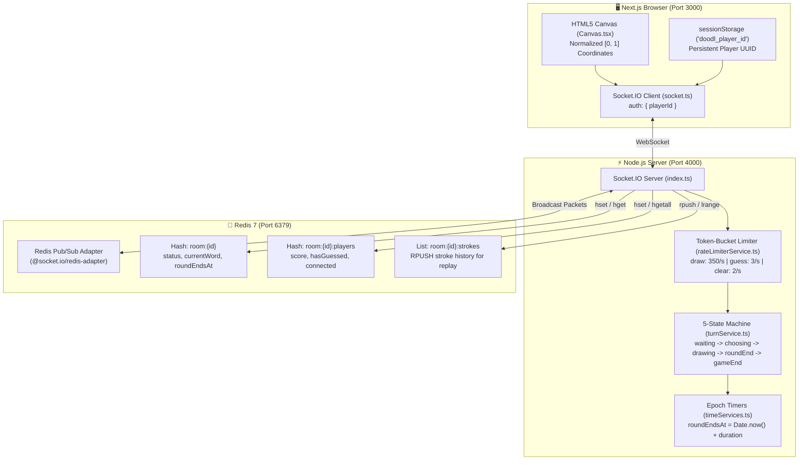

# 🎨 Doodl.io — Real Architecture & Interview Defense Guide
*(100% Grounded in Actual Code — No Fluff, No Fumbling)*

> **Your Safety Guarantee:** Every single concept, number, and explanation in this document is **already implemented in your repository**. There are **no theoretical or made-up tools** (no Nginx, no AWS, no Kafka). You can open the actual files and see the exact code.

---

## 📑 Table of Contents
1. [The 30-Second Interview Pitch (How to Answer "Tell me about this")](#1-the-30-second-interview-pitch)
2. [What Actually Runs (The 3 Components)](#2-what-actually-runs-the-3-components)
3. [The Exact Code Architecture & Flow Diagram](#3-the-exact-code-architecture--flow-diagram)
4. [Step-by-Step: How Every Event Actually Moves Through the System](#4-step-by-step-how-every-event-actually-moves-through-the-system)
   - [Event 1: Drawing a Stroke](#event-1-drawing-a-stroke)
   - [Event 2: Making a Guess & Close-Guess Whispers](#event-2-making-a-guess--close-guess-whispers)
   - [Event 3: A Player's Wi-Fi Drops (20s Grace & Replay)](#event-3-a-players-wi-fi-drops-20s-grace--replay)
5. [Defending Your 3 Resume Bullets (Simple Speaking Scripts)](#5-defending-your-3-resume-bullets)
   - [Bullet 1: Redis Pub/Sub, State Decoupling & 165 strokes/sec](#bullet-1-redis-pubsub-state-decoupling--165-strokessec)
   - [Bullet 2: Zero-Trust 5-State Machine & Epoch Timers](#bullet-2-zero-trust-5-state-machine--epoch-timers)
   - [Bullet 3: 20s Disconnect Grace & Token-Bucket Rate Limiter](#bullet-3-20s-disconnect-grace--token-bucket-rate-limiter)
6. [Top 5 Direct Interview Questions & Truthful Answers](#6-top-5-direct-interview-questions--truthful-answers)

---

## 1. The 30-Second Interview Pitch

When the interviewer asks: **"Walk me through your Doodl.io project."**

### 🗣️ Say this exact script:
> *"Doodl.io is a real-time multiplayer drawing and guessing game built with Next.js, Node.js, Socket.IO, and Redis.*
> 
> *Instead of storing active game state in regular JavaScript variables in Node.js memory—which would wipe games if the server restarts and prevents running multiple servers—I decoupled all room metadata, player scores, and stroke history into Redis.*
> 
> *I built an authoritative 5-state game machine to prevent cheating, an epoch-based timer system so players can't tamper with round clocks, a 20-second disconnect grace window with full canvas replay, and an in-memory token-bucket rate limiter to protect the Node.js event loop.*
> 
> *I also wrote an automated load test in TypeScript with 20 concurrent bot clients across 5 rooms. It sustained ~165 strokes per second with 100% delivery and a 4ms p95 latency."*

---

## 2. What Actually Runs (The 3 Components)

In your actual project, exactly three processes run:
1. **Frontend Client (`client/`):** Next.js 15 on port `3000`. Handles the HTML5 Canvas, UI components, sounds, and browser socket connection.
2. **Backend Server (`server/`):** Node.js + Express + Socket.IO on port `4000`. Handles game rules, timers, guess checking, and rate limits.
3. **Database (`Redis 7`):** Runs on port `6379`. Stores room data, player lists, stroke arrays, and handles cross-server messaging via Redis Pub/Sub.

---

## 3. The Exact Code Architecture & Flow Diagram



Here is the exact data flow matching the files in your project:



---

## 4. Step-by-Step: How Every Event Actually Moves Through the System

### Event 1: Drawing a Stroke
* **File location:** [`client/src/components/canvas/useCanvasDrawing.ts`](file:///c:/Users/divya/Projects/skribble-clone/client/src/components/canvas/useCanvasDrawing.ts) $\rightarrow$ [`server/src/handlers/draw/onDraw.ts`](file:///c:/Users/divya/Projects/skribble-clone/server/src/handlers/draw/onDraw.ts)

1. **Player moves mouse:** The client captures `(x, y)` on the HTML5 canvas. It divides the pixel values by canvas width and height so they become normalized numbers between `0.0` and `1.0`.
2. **Client emits event:** `socket.emit("draw", { stroke: { points: [{x, y}], color, width } })`.
3. **Server checks rate limit:** `checkRateLimit(socket.id, "draw")`. If the user is spamming faster than 350 tokens/sec, the stroke is dropped.
4. **Server checks authorization:** Verifies that `socket.data.playerId` is the designated `currentDrawerId` for that room.
5. **Saved to Redis:** `strokeService.ts` calls `redis.rpush(`room:${roomId}:strokes`, JSON.stringify(stroke))`.
6. **Broadcasted:** `socket.to(roomId).emit("draw", { stroke })`. Redis Pub/Sub forwards it to everyone else in the room.

---

### Event 2: Making a Guess & Close-Guess Whispers
* **File location:** [`server/src/handlers/chat/onGuess.ts`](file:///c:/Users/divya/Projects/skribble-clone/server/src/handlers/chat/onGuess.ts) $\rightarrow$ [`server/src/services/chatService.ts`](file:///c:/Users/divya/Projects/skribble-clone/server/src/services/chatService.ts)

1. **Player types word in chat:** Client emits `guess` with `{ text }`.
2. **Rate limit check:** Max 3 guesses/sec (stops bots trying dictionary brute-force).
3. **Drawer check:** If the drawer tries to guess, it's rejected.
4. **Word comparison:**
   * **Exact match:**
     * Marked in Redis: `hasGuessed = true`.
     * Points calculated: faster guess = more points (up to 500).
     * Server emits to the room: `playerGuessed` (*"Alice guessed the word!"*). The word is **never shown in chat**.
   * **Close guess:**
     * The server calculates the **Levenshtein distance** (spelling edit distance).
     * If the distance is $\le 2$ (e.g. `appl` instead of `apple`), the server emits a private message **only to that player's socket**: `closeGuess` (*"You are very close!"*).
     * It is **not** broadcasted to the room, so other players can't copy it.
   * **Normal message:** Broadcasted to the room chat as regular conversation.

---

### Event 3: A Player's Wi-Fi Drops (20s Grace & Replay)
* **File location:** [`server/src/handlers/room/disconnect.ts`](file:///c:/Users/divya/Projects/skribble-clone/server/src/handlers/room/disconnect.ts) $\rightarrow$ [`server/src/handlers/room/joinRoom.ts`](file:///c:/Users/divya/Projects/skribble-clone/server/src/handlers/room/joinRoom.ts)

1. **Connection Drops:** The WebSocket disconnects.
2. **Server doesn't delete the player:** Instead, in `disconnect.ts`, the server:
   * Sets `connected: false` in Redis for that player.
   * Starts a 20-second timer: `setTimeout(..., 20000)`.
   * Broadcasts to the room that the player is temporarily disconnected.
3. **Player returns within 20 seconds:**
   * When the player re-opens the page, Next.js reads their existing UUID from `sessionStorage.getItem('doodl_player_id')`.
   * Socket connects with `auth: { playerId }`.
   * In `joinRoom.ts`, `cancelDisconnectGracePeriod(playerId)` clears the 20-second timer.
   * Player's status is set back to `connected: true`.
4. **Canvas Replay (`canvasSync`):**
   * Server executes `redis.lrange(`room:${roomId}:strokes`, 0, -1)`.
   * Emits `socket.emit("canvasSync", { strokes })`.
   * The client canvas loops through the strokes array and redraws the exact artwork in under 50ms.
5. **What if 20 seconds pass?** The timer fires, permanently removes the player from the room, and if they were host, transfers host status to the next player.

---

## 5. Defending Your 3 Resume Bullets

### Bullet 1: Redis Pub/Sub, State Decoupling & 165 strokes/sec
> *"Created a horizontally scalable real-time engine with Socket.IO and Redis Pub/Sub, sustaining ~165 strokes/sec at 4ms p95 broadcast latency by moving room state out of Node.js memory."*

* **Where is this in the code?**
  * Decoupling: Look at [`server/src/services/roomService.ts`](file:///c:/Users/divya/Projects/skribble-clone/server/src/services/roomService.ts) and [`playerService.ts`](file:///c:/Users/divya/Projects/skribble-clone/server/src/services/playerService.ts). Notice there are **zero global variables** storing rooms. Everything is `redis.hset`, `redis.hget`, `redis.rpush`.
  * Pub/Sub Adapter: Look at lines 40–46 in [`server/src/index.ts`](file:///c:/Users/divya/Projects/skribble-clone/server/src/index.ts):
    ```typescript
    const pubClient = redis.duplicate();
    const subClient = redis.duplicate();
    io.adapter(createAdapter(pubClient, subClient));
    ```
  * Benchmark: Look at [`server/scripts/loadTest.ts`](file:///c:/Users/divya/Projects/skribble-clone/server/scripts/loadTest.ts):
    * Runs 5 rooms $\times$ 4 clients per room = **20 concurrent clients**.
    * Emits strokes at 30ms intervals ($\approx 33$ strokes/sec per room $\times 5$ rooms $\approx$ **165 strokes/sec**).
    * Calculates median latency (3ms) and **p95 latency (4ms)** with 100% delivery.

* **🗣️ How to explain it:**
  > *"Most toy WebSocket projects keep rooms in a JavaScript `Map`. That causes two problems: if the server restarts, all games are deleted; and you can only ever run a single server.  
  > In Doodl.io, I decoupled room state into Redis. I plugged `@socket.io/redis-adapter` into Socket.IO using two duplicated Redis clients—one for publishing and one for subscribing.  
  > To prove it performs, I wrote a load test script in TypeScript (`loadTest.ts`) simulating 20 automated clients across 5 rooms. It sustained 165 strokes per second with a 4ms p95 latency."*

---

### Bullet 2: Zero-Trust 5-State Machine & Epoch Timers
> *"Constructed a zero-trust, server-authoritative 5-state machine with epoch-anchored timers and server-side word masking, preventing client clock manipulation and payload tampering."*

* **Where is this in the code?**
  * 5 States: Defined in [`server/src/types/events.ts`](file:///c:/Users/divya/Projects/skribble-clone/server/src/types/events.ts): `"waiting" | "choosing" | "drawing" | "roundEnd" | "gameEnd"`.
  * Managed in: [`server/src/services/turnService.ts`](file:///c:/Users/divya/Projects/skribble-clone/server/src/services/turnService.ts).
  * Word Masking: In [`server/src/handlers/game/wordSelect.ts`](file:///c:/Users/divya/Projects/skribble-clone/server/src/handlers/game/wordSelect.ts):
    * The secret word is stored **only in Redis** (`room.currentWord`).
    * Guessers receive `maskedWord` (e.g. `_ _ _ _ _`).
    * Non-drawers never receive the plaintext word over the WebSocket until `roundEnd`.
  * Epoch Timers: In [`server/src/services/timeServices.ts`](file:///c:/Users/divya/Projects/skribble-clone/server/src/services/timeServices.ts):
    * Instead of a client countdown, the server sets `roundEndsAt = Date.now() + (drawTime * 1000)`.
    * Remaining time is always `(roundEndsAt - Date.now()) / 1000`.

* **🗣️ How to explain it:**
  > *"We follow a zero-trust model where the client is never trusted:  
  > 1. In basic games, servers send the secret word to all clients and just hide it with CSS—meaning anyone opening Chrome DevTools can see the word. In our server, the word is sent only to the drawer. Guessers only get masked underscores. The real word stays in Redis.  
  > 2. For timers, simple `setInterval` countdowns drift when the CPU is busy, and client timers can be manipulated. We anchor every round to an absolute epoch timestamp: `roundEndsAt = Date.now() + duration`. The remaining time is mathematically determined by the server, so no client can extend their drawing time."*

---

### Bullet 3: 20s Disconnect Grace & Token-Bucket Rate Limiter
> *"Established fault-tolerant state recovery with an append-only Redis stroke log and a 20s reconnect grace period, protecting the event loop via per-socket token-bucket rate limiting."*

* **Where is this in the code?**
  * 20s Grace Period: In [`server/src/handlers/room/disconnect.ts`](file:///c:/Users/divya/Projects/skribble-clone/server/src/handlers/room/disconnect.ts) line 120 (`setTimeout(..., 20000)`).
  * Canvas Replay: In [`server/src/handlers/room/joinRoom.ts`](file:///c:/Users/divya/Projects/skribble-clone/server/src/handlers/room/joinRoom.ts) lines 96–99 (`socket.emit("canvasSync", { strokes })`).
  * Token-Bucket Limiter: In [`server/src/services/rateLimiterService.ts`](file:///c:/Users/divya/Projects/skribble-clone/server/src/services/rateLimiterService.ts):
    * `draw`: capacity 500, refill 350 tokens/sec
    * `guess`: capacity 5, refill 3 tokens/sec
    * `clearCanvas`: capacity 5, refill 2 tokens/sec
    * Checked at the top of `onDraw.ts` and `onGuess.ts`.

* **🗣️ How to explain it:**
  > *"In real life, people's Wi-Fi flickers or they accidentally refresh the page. Instead of kicking them out and losing their score, we give them a 20-second grace period. The tab preserves a UUID in `sessionStorage`. When they reconnect, the server restores their seat and replays all previous strokes from our Redis list (`RPUSH`/`LRANGE`).  
  > To protect our single-threaded Node.js event loop from getting flooded by scripts or spam, I wrote an in-memory token-bucket rate limiter. For drawing, it allows a burst up to 500 tokens (for quick mouse curves) but caps steady rate at 350 strokes/second. For guessing, it allows 3 guesses/sec to stop dictionary bots."*

---

## 6. Top 5 Direct Interview Questions & Truthful Answers

### Q1: "Why did you use Redis instead of PostgreSQL or MongoDB?"
> **Your Answer:**  
> *"Speed and data lifecycle. Drawing games generate 50 to 100 events per second. Writing every single vector coordinate to disk in PostgreSQL would create massive I/O bottlenecks and latency.  
> Redis stores data in RAM, giving us sub-millisecond read/write speeds. Also, Redis Hashes have built-in TTL (Time-To-Live), so when a game room finishes, the room data and strokes automatically expire after 2 hours without needing manual cleanup scripts."*

---

### Q2: "How does the canvas look the same on different screen sizes?"
> **Your Answer:**  
> *"We normalize coordinates between 0.0 and 1.0.  
> Instead of sending `x=400, y=300`, we divide by canvas width and height so the coordinate is sent as decimals like `x=0.5, y=0.5`.  
> When another device receives those floats—whether it's a mobile screen or a 4K monitor—it multiplies the floats by its own local canvas dimensions. That guarantees the drawing renders with the exact same proportions everywhere."*

---

### Q3: "What happens if a player disconnects while it is their turn to draw?"
> **Your Answer:**  
> *"If the active drawer disconnects, the 20-second grace period starts. But if they don't return within the 20 seconds, the server marks them as gone, cancels their turn, calls `handleTurnEnd(io, roomId, 'Drawer disconnected!')`, reveals the word, and advances the game to the next player's turn so the room doesn't freeze."*

---

### Q4: "Why token-bucket rate limiting instead of a simple counter?"
> **Your Answer:**  
> *"A simple fixed-window counter resets at exact clock intervals. A user could send 500 requests at the very end of second 1, and another 500 requests at the start of second 2—dumping 1,000 requests in 50 milliseconds.  
> The token-bucket algorithm refills continuously over time. It allows natural human bursts—like quickly sketching a curve—up to the bucket's capacity, while strictly enforcing the steady rate of 350 strokes/second to protect the Node.js event loop."*

---

### Q5: "What is one challenge you faced and how did you solve it?"
> **Your Answer:**  
> *"Managing player identity across page refreshes. Initially, Socket.IO generated a new `socket.id` on every refresh, which destroyed the player's score and room state.  
> I solved this by decoupling player identity from the socket connection. I generated a persistent UUID stored in `sessionStorage` (`doodl_player_id`) and passed it in the Socket.IO auth handshake. That combined with our 20-second disconnect grace window made page refreshes completely seamless."*

---

## 🎯 Cheat Sheet Summary for Your Pocket:
* **Ports:** Client: `3000` | Server: `4000` | Redis: `6379`
* **Benchmark:** 20 clients (5 rooms $\times$ 4), 165 strokes/sec, 4ms p95 latency.
* **5 States:** `waiting` $\rightarrow$ `choosing` $\rightarrow$ `drawing` $\rightarrow$ `roundEnd` $\rightarrow$ `gameEnd`.
* **Grace Period:** 20 seconds.
* **Draw Rate Limit:** 500 capacity, 350 tokens/sec.
* **Guess Rate Limit:** 5 capacity, 3 tokens/sec.
