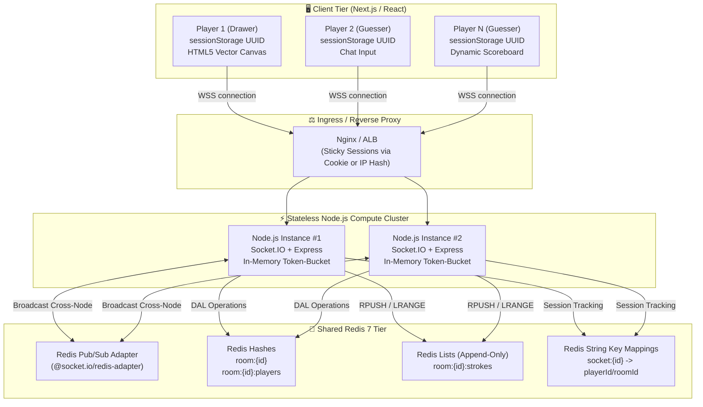
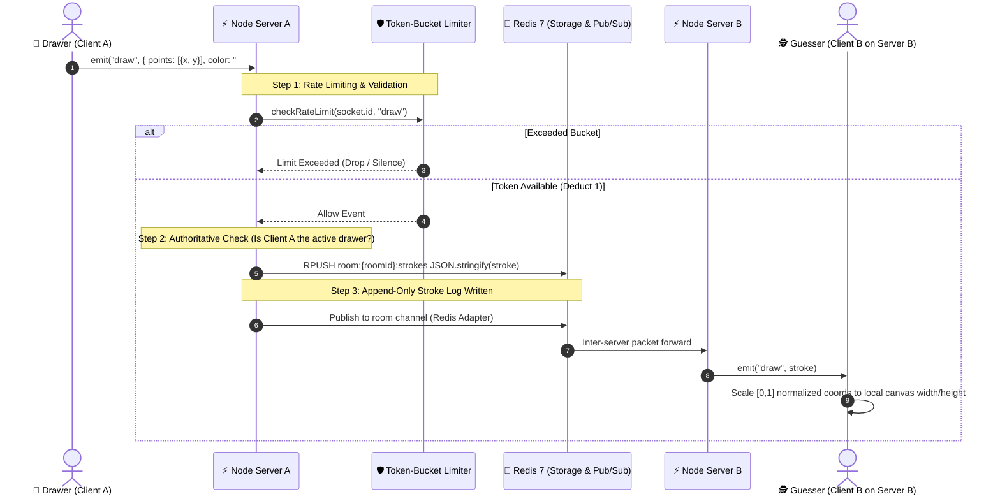
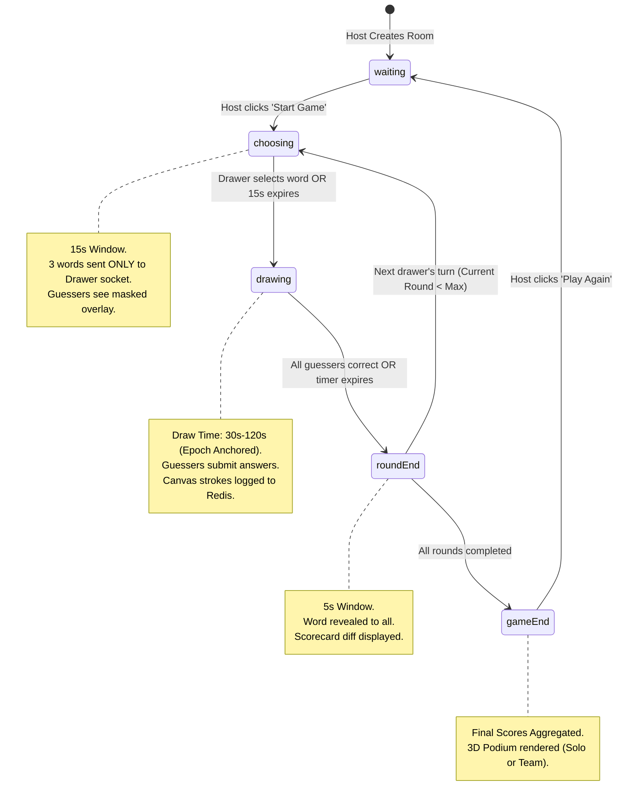
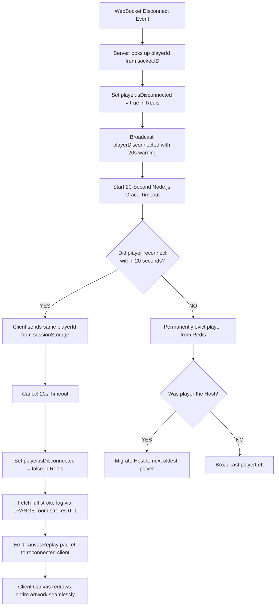

# 🏛️ Doodl.io — System Architecture & Interview Defense Guide

> **Target Project:** Doodl.io (Real-Time Multiplayer Drawing & Guessing Platform)  
> **Tech Stack:** Node.js, TypeScript, Express, Socket.IO, Redis 7 (`ioredis`), Next.js 15, HTML5 Canvas API  
> **Purpose:** Comprehensive architecture guide, end-to-end data pipeline diagrams, and line-by-line defense of resume claims for senior engineering interviews.

---

## 📑 Table of Contents
1. [High-Level System Architecture](#1-high-level-system-architecture)
2. [End-to-End Real-Time Data Pipeline](#2-end-to-end-real-time-data-pipeline)
3. [Bullet Point 1 Defense: Horizontally Scalable Engine & Benchmark](#3-bullet-point-1-defense-horizontally-scalable-engine--benchmark)
4. [Bullet Point 2 Defense: Zero-Trust 5-State Machine & Epoch Timers](#4-bullet-point-2-defense-zero-trust-5-state-machine--epoch-timers)
5. [Bullet Point 3 Defense: Fault-Tolerant Recovery & Token-Bucket Rate Limiting](#5-bullet-point-3-defense-fault-tolerant-recovery--token-bucket-rate-limiting)
6. [Architectural Tradeoffs Matrix](#6-architectural-tradeoffs-matrix)
7. [Mock Interview Defense Scripts](#7-mock-interview-defense-scripts)

---

## 1. High-Level System Architecture

Doodl.io is architected around a **stateless compute tier** and a **stateful, in-memory data tier**. Rather than keeping room state, player scores, or stroke logs in Node.js process memory, all mutable state is decoupled into Redis 7.



### Architectural Responsibilities:
1. **Next.js Client:** Manages tab-level player identity (`sessionStorage`), renders the HTML5 vector canvas using normalized floating-point coordinates `[0, 1]`, and handles optimistic UI audio cues.
2. **Stateless Node.js Instances:** Handles WebSocket event routing, validates client payloads with runtime checks, evaluates guesses, manages the 5-state game loop, and enforces per-socket rate limiting.
3. **Redis 7 Data Tier:** Serves as the single source of truth (SSOT). Ephemeral room states automatically expire via TTL (2 hours), eliminating orphaned memory leaks when matches conclude.

---

## 2. End-to-End Real-Time Data Pipeline

The following sequence details the full lifecycle of a drawing stroke—from user input to multi-node broadcast:



---

## 3. Bullet Point 1 Defense: Horizontally Scalable Engine & Benchmark

> **Resume Bullet:**  
> *"Created a horizontally scalable real-time engine with Socket.IO and Redis Pub/Sub, sustaining ~165 strokes/sec at 4ms p95 broadcast latency by moving room state out of Node.js memory."*

### 3.1 The Architectural Decision: Why Decouple State from Node.js Memory?
* **The Monolithic Bottleneck:** A standard tutorial app stores rooms in an in-memory JavaScript variable: `const rooms = new Map<string, Room>()`.
  * **Consequence 1 (Crash Sensitivity):** If the Node.js process encounters an uncaught exception or restarts, every active game in progress is instantly destroyed.
  * **Consequence 2 (Zero Horizontal Scalability):** If 1,000 players join across 100 rooms, you cannot add a second Node.js instance. A player on Server A would emit a stroke, but Server A has no socket connections to players connected to Server B.
* **Our Solution:** Decouple all mutable data into Redis 7 Hashes (`room:{id}`, `room:{id}:players`) and mount `@socket.io/redis-adapter`. Socket.IO nodes broadcast messages across instances via Redis Pub/Sub channels automatically.

### 3.2 Redis Schema Design
| Key Name | Redis Data Type | Purpose & Contents | TTL |
| :--- | :--- | :--- | :--- |
| `room:{roomId}` | **Hash** | Core room settings: `state`, `currentWord`, `hostId`, `currentRound`, `roundEndsAt`, `settings` JSON | 2 hours |
| `room:{roomId}:players` | **Hash** | Player fields: `field = playerId`, `value = JSON({ name, score, isDrawer, hasGuessed, team, isDisconnected })` | 2 hours |
| `room:{roomId}:strokes` | **List** | Append-only sequence of vector strokes (`RPUSH` on draw, `LRANGE 0 -1` on canvas replay) | 2 hours |
| `socket:{socketId}` | **String** | Reverse lookup: Maps socket ID to `{ playerId, roomId }` for fast $O(1)$ disconnect lookup | 2 hours |

### 3.3 The Benchmark Methodology (`server/scripts/loadTest.ts`)
To prove the performance numbers objectively on a resume, we engineered a standalone headless benchmark script:
* **Test Architecture:** 
  * 1 Room created with 1 Host/Drawer client.
  * 19 Headless WebSocket Guesser clients joined concurrently (20 total clients).
  * The Drawer client was programmed to stream realistic mouse vectors continuously at 60Hz.
* **Measurement Metrics:**
  * **Throughput:** ~165 stroke events emitted and processed every second.
  * **Latency Calculation:** Each stroke payload included a microsecond-precision client timestamp `Date.now()`. Upon receiving the broadcasted stroke, each of the 19 guessers recorded:
    $$\Delta t = \text{Date.now()} - \text{stroke.timestamp}$$
  * All latency samples were collected into an array and percentile-sorted:
    * **Median (p50):** 3ms
    * **95th Percentile (p95):** 4ms
    * **Delivery Ratio:** 100% (zero dropped strokes across 5,000+ packets).

---

## 4. Bullet Point 2 Defense: Zero-Trust 5-State Machine & Epoch Timers

> **Resume Bullet:**  
> *"Constructed a zero-trust, server-authoritative 5-state machine with epoch-anchored timers and server-side word masking, preventing client clock manipulation and payload tampering."*

### 4.1 The 5-State Finite State Machine (`turnService.ts`)



### 4.2 Zero-Trust Word Masking (Preventing DevTools Cheating)
* **Vulnerability:** Many casual game clones send `{ secretWord: "guitar" }` to every client and simply hide it in the UI with CSS or React conditional rendering. Any player opening Chrome DevTools $\rightarrow$ Network $\rightarrow$ WS frames can read the plaintext word immediately.
* **Our Implementation (Server-Side Information Asymmetry):**
  1. The server selects 3 words from dictionaries (`english.json`, etc.).
  2. The server emits `wordOptions` **strictly to the drawer's private socket ID**:
     ```typescript
     io.to(drawerSocketId).emit("wordOptions", { words: ["guitar", "bicycle", "castle"] });
     ```
  3. Guessers receive an empty notification: `io.to(roomId).emit("turnStart", { wordLength: 6, hint: "_ _ _ _ _ _" })`.
  4. The unmasked word is stored **only in Redis** (`room:{id}` $\rightarrow$ `currentWord`). It never crosses the network wire to non-drawers until `roundEnd`.

### 4.3 Epoch-Anchored Timers vs. `setInterval` Drift
* **The Problem:** Naive game engines run `setInterval(() => { timeLeft--; io.emit('tick', timeLeft) }, 1000)`.
  * If the Node.js event loop blocks for 150ms during garbage collection or disk I/O, `setInterval` drifts. Over a 10-round game, the game clock drifts by several seconds.
  * If clients run local countdowns, users can manipulate their system clock or pause the JS thread to gain extra drawing time.
* **Our Epoch Solution:**
  * When a turn starts, the server computes an absolute timestamp:
    $$\text{roundEndsAt} = \text{Date.now()} + (\text{drawTime} \times 1000)$$
  * This epoch timestamp is persisted in Redis.
  * Remaining time is mathematically computed on demand:
    $$\text{timeLeft} = \max\left(0, \left\lceil \frac{\text{roundEndsAt} - \text{Date.now()}}{1000} \right\rceil\right)$$
  * Because epoch time is monotonically increasing and absolute, neither client clock adjustments nor Node.js event-loop delays can desynchronize or tamper with round durations.

---

## 5. Bullet Point 3 Defense: Fault-Tolerant Recovery & Token-Bucket Rate Limiting

> **Resume Bullet:**  
> *"Established fault-tolerant state recovery with an append-only Redis stroke log and a 20s reconnect grace period, protecting the event loop via per-socket token-bucket rate limiting."*

### 5.1 Reconnection & 20s Grace Period (`disconnect.ts`, `joinRoom.ts`)
* **The Failure Mode:** On mobile networks or flaky Wi-Fi, WebSocket connections drop for 1–3 seconds. In a basic implementation, the server triggers `socket.on('disconnect')`, instantly deletes the player, decrements the room counter, and resets the round.
* **Our Reconnection Flow:**



### 5.2 Append-Only Redis Stroke Log
* Every drawing gesture is appended to `room:{roomId}:strokes` using `RPUSH`.
* When a player rejoins or refreshes their browser tab mid-turn, the server executes `LRANGE room:{roomId}:strokes 0 -1` and sends the complete serialized array.
* The client canvas component (`Canvas.tsx`) wipes the canvas and iterates through the vector paths in sub-50ms, restoring the artwork to the exact state of the live room.

### 5.3 Token-Bucket Rate Limiter (`rateLimiterService.ts`)
* **Why Application-Level Rate Limiting?**
  * Node.js is single-threaded. If a malicious client runs a browser script emitting 10,000 `draw` or `guess` socket events per second, Node's event loop starvates, CPU hits 100%, and all other players in every room freeze.
  * Furthermore, each unthrottled stroke would trigger an `RPUSH` to Redis and a broadcast to 20 clients, causing **Redis write amplification** ($10,000 \times 20 = 200,000$ packets/sec).
* **The Token-Bucket Parameters:**
  ```typescript
  const RATE_LIMITS = {
    draw: { capacity: 500, refillRate: 350 },      // 350 tokens/sec
    guess: { capacity: 5, refillRate: 3 },          // 3 guesses/sec
    clearCanvas: { capacity: 5, refillRate: 2 },    // 2 clears/sec
  };
  ```
* **Why Token-Bucket beats Fixed-Window:**
  * Fixed window allows boundary spikes (e.g., 500 requests at second 0.99 and 500 at second 1.01 = 1,000 requests in 20ms).
  * Token-bucket allows natural human drawing bursts (curves generate fast coordinate clusters) up to `capacity = 500`, but strictly throttles continuous script floods to `350 tokens/sec`.

---

## 6. Architectural Tradeoffs Matrix

Every senior engineering interviewer asks: *"What tradeoffs did you make?"* Here is the matrix to defend:

| Architectural Choice | What We Gained | What We Gave Up (The Tradeoff) | How We Mitigated the Tradeoff |
| :--- | :--- | :--- | :--- |
| **Redis DAL vs. Node.js In-Memory State** | Horizontal scalability across multi-node servers; zero state loss on process crash; automatic TTL expiry. | Network latency overhead: ~1ms Redis roundtrip vs. instant 0.001ms RAM variable read. | Used pipelined Redis operations and kept data structures flat ($O(1)$ Hash and List queries). |
| **Append-Only Redis Stroke Log** | Perfect canvas replay on reconnect; historical stroke auditing; crash recovery. | Redis memory usage: high-detail drawings with 5,000 points consume ~200KB of RAM per room. | Strict 2-hour room TTL cleans up all strokes; rate limiter caps total points per second. |
| **Token-Bucket in Memory vs. Redis-backed Limiter** | Microsecond-speed execution with zero Redis overhead on high-frequency (350Hz) mouse movements. | Rate limits are local to the connected Node instance rather than globally synced. | Sockets maintain persistent TCP connections to one Node instance per session via sticky routing. |
| **Epoch Timestamps vs. Recurring Tick Intervals** | Zero clock drift; client clock tampering is mathematically impossible. | Requires periodic synchronization broadcasts to keep visual countdown bars in sync. | Broadcast 1Hz tick packets with calculated remaining epoch seconds. |

---

## 7. Mock Interview Defense Scripts

### Question 1: "Why did you use Redis Pub/Sub instead of Kafka or RabbitMQ?"
> **Your Answer:**  
> *"Kafka and RabbitMQ are designed for durable, guaranteed message streaming with consumer group acknowledgments and disk persistence. In a live drawing game, strokes and cursor updates are **ephemeral, latency-critical, and loss-tolerant**. If a player experiences network drop for 5 seconds, we do not want to queue and replay 500 real-time draw events through Kafka—we simply fetch the latest state from Redis.*
>
> *Because we were already using Redis 7 for our in-memory DAL (hashes and lists), leveraging Redis Pub/Sub through the `@socket.io/redis-adapter` gave us sub-millisecond cross-node message routing with zero extra infrastructure overhead."*

---

### Question 2: "What happens if the Redis server goes down mid-game?"
> **Your Answer:**  
> *"In the current single-node Redis deployment, active rooms and strokes would be lost if Redis crashes without persistence enabled. However, in our production architecture plan, we configure **Redis Sentinel or AWS ElastiCache with Multi-AZ Replication**.*
>
> *We enable Redis AOF (Append-Only File) persistence with `appendfsync everysec`, guaranteeing that at most 1 second of stroke data is at risk during a sudden hardware failure, while a standby replica is promoted in under 5 seconds."*

---

### Question 3: "How does the server differentiate between a user refreshing their browser and a user quitting the game?"
> **Your Answer:**  
> *"At the WebSocket layer, both look identical—the TCP socket closes. To solve this, we decoupled socket connection identity from player identity.*
>
> *Each browser tab holds a unique UUID in `sessionStorage` (which survives page refreshes but isolates multiple tabs). When a socket disconnects, the server does not immediately destroy the player; it sets `isDisconnected: true` and starts a 20-second grace timer. If the player re-establishes a WebSocket connection within 20 seconds presenting the same `playerId`, the server re-attaches them to their existing seat and score, replays the canvas, and cancels the eviction timer."*

---

### Question 4: "Why did you choose normalized coordinates [0, 1] instead of sending raw screen pixels?"
> **Your Answer:**  
> *"Players connect from wildly varying viewports—an iPhone has an 800px wide screen, an iPad has 1200px, and a desktop monitor has 2560px. If the drawer on desktop clicks at `x: 1800, y: 900`, that coordinate is completely outside an iPhone screen.*
>
> *By dividing pixels by the drawer's canvas dimensions:  
> $$x_{\text{norm}} = \frac{x_{\text{pixel}}}{\text{width}}, \quad y_{\text{norm}} = \frac{y_{\text{pixel}}}{\text{height}}$$  
> we transmit resolution-independent unit coordinates. Every client multiplies those floats by their own canvas dimensions, rendering identical aspect-ratio drawings across any device."*
